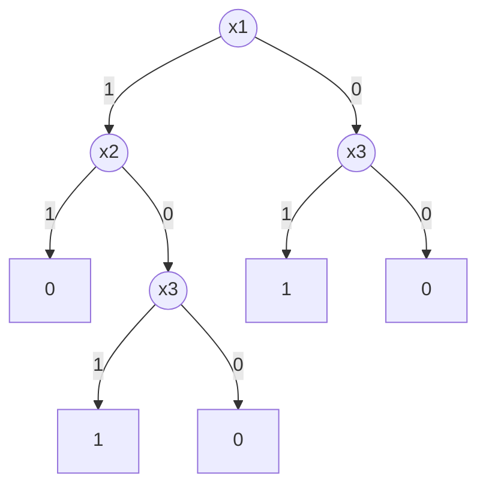
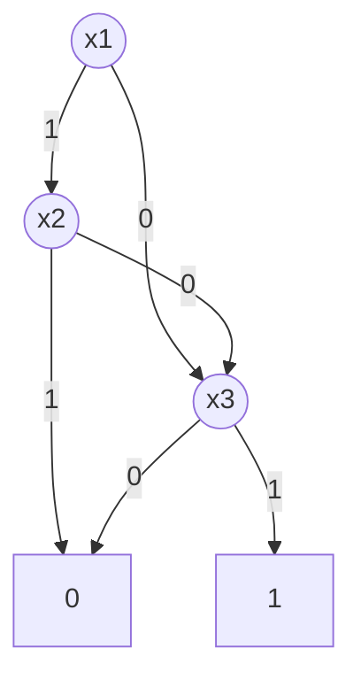

# Capítulo 1a: Terminologia, Decidibilidade e Satisfabilidade

> **Versão corrigida** (2026-11-19) do documento Paper com o mesmo título.
> As marcas [Cn] remetem para os pontos de `Avaliacao-Cap1a-2026-11-19.md`, onde se explica cada alteração.
> As verificações numéricas estão em `cap1a_verificacoes.py` (notebook Marimo).
> As figuras do original foram substituídas por diagramas Mermaid reconstruídos a partir das fórmulas do texto.

---

## Terminologia da Lógica

Uma lógica é uma linguagem $L$, cujos elementos se designam por *frases*. Quando as frases formam um conjunto enumerável e finitamente gerado, a lógica diz-se *formal* e as frases designam-se por *fórmulas*.

Quando frases (mesmo "informais") se agrupam num conjunto a que se associa uma identidade própria, esse conjunto designa-se por *conjunção*. Frases e conjunções têm o nome genérico de *asserções*.

A lógica tem por objetivo descrever duas noções fundamentais que associamos às asserções, nomeadamente às conjunções: a noção de *validade* e a noção de *inconsistência*.

Estas noções nunca são independentes: existem relações estruturais que as ligam. Nomeadamente:

- A conjunção vazia é sempre válida.
- Se a linguagem for não trivial, então a conjunção de todas as suas frases é inconsistente.
- Se a linguagem contiver negação e a lógica for **clássica**, então o juízo
  "se $\{A_1,\cdots,A_k\}$ é uma conjunção válida então $\{B_1,\cdots,B_n\}$ é uma conjunção válida"
  é equivalente ao juízo
  "**para todo** $i=1..n$, a conjunção $\{A_1,\cdots,A_k,\neg B_i\}$ é inconsistente".[C1]
  (Numa lógica intuicionista só se garante uma direção: da inconsistência de $\{A_1,\cdots,A_k,\neg B_i\}$ obtém-se apenas $\neg\neg B_i$.)
- Se a lógica for *monótona* e se verificar o juízo "se $\Gamma$ é válida então $\Delta$ é válida", então, para qualquer asserção $A$, também se verifica "se $\Gamma\cup\{A\}$ é válida então $\Delta$ é válida". Ou seja, acrescentar hipóteses nunca invalida uma conclusão.[C7]

Este ou outro conjunto de regras lidam com *juízos* sobre o significado das asserções. São juízos construções como

- absurdo
- ⟨conjunção⟩ é válida
- ⟨conjunção⟩ é inconsistente
- se ⟨precedente⟩ então ⟨conclusão⟩

A construção "se $P$ então $C$" pode ser interpretada de várias formas, nomeadamente:

- sempre que $P$ ocorre também ocorre $C$ $\;\equiv\;$ juízos interpretados como eventos;
- $P$ é causa suficiente para $C$ $\;\equiv\;$ juízos interpretados como causa-efeito;
- $P$ é evidência que assegura $C$ $\;\equiv\;$ visão **epistémica** (ou probatória) dos juízos.[C24]

Ambas as noções (validade e inconsistência) podem ser definidas de forma sintática e de forma semântica.

## Contexto Sintático (Teoria da Prova)

No contexto sintático, o objetivo de uma lógica formal $L$ concretiza-se através de uma *relação de inferência* $\vdash$ determinada por

- um conjunto de *axiomas*, que são fórmulas válidas por definição, e
- um conjunto de *regras de inferência*, que constroem uma nova asserção, a *conclusão* da regra, a partir de outras asserções, ditas as *hipóteses* da regra.

As hipóteses também se designam por *assunções*. No contexto sintático, a noção de validade é determinada por *provas*.

Sintaticamente, uma prova é um grafo orientado, acíclico e com raiz (*rooted acyclic diagram*) que tem fórmulas como nodos. A raiz do diagrama designa-se por *conclusão* da prova.

> *[Figura do original: diagrama de uma prova.]*

A relação de inferência ocorre numa prova bem construída de duas formas:

- As *fontes* do diagrama (nodos sem antecedentes) ou são axiomas da lógica, e podem ocorrer em qualquer prova, ou são específicas de uma determinada prova e designam-se por *assunções* dessa prova.
- Os restantes nodos da prova são construídos por aplicação das regras de inferência: um nodo pertence à prova se é conclusão de uma regra de inferência cujas hipóteses pertencem à prova.

Se existe uma prova bem construída com assunções $A_1,\cdots,A_k$ e conclusão $B$, escreve-se

$$A_1,\cdots,A_k\;\vdash\;B$$

No contexto sintático temos:

- Uma fórmula $A$ é *válida* (ou *teorema*), e escreve-se $\vdash A$, se e só se é a conclusão de uma prova **sem assunções**, isto é, cujas fontes são todas axiomas.[C30]
- Uma conjunção $\Gamma$ é válida se todas as fórmulas $A\in\Gamma$ são válidas.
- Uma conjunção $\Gamma$ é *inconsistente* se e só se, para toda a fórmula $C\in L$, existe uma prova bem construída $\Gamma\vdash C$.

Note-se que, sendo $\Gamma$ inconsistente, consegue-se provar ambas as inferências $\Gamma\vdash C$ e $\Gamma\vdash\neg C$; isto é, prova-se a partir das assunções em $\Gamma$ que qualquer fórmula $C$ e a sua negação $\neg C$ são conclusões bem construídas.

Nas lógicas que têm o axioma *Ex Falso Quodlibet* (ver exemplo abaixo), $\Gamma$ é inconsistente se e só se $\Gamma\vdash\bot$. Na Lógica Mínima as duas noções separam-se: pode ter-se $\Gamma\vdash\bot$ sem que $\Gamma$ prove todas as fórmulas.[C30]

No contexto sintático, uma *teoria* é um subconjunto da lógica $T\subseteq L$ que é fechado pela relação de inferência; isto é, se as assunções $A_1,\cdots,A_k$ são elementos da teoria $T$ e se $A_1,\cdots,A_k\vdash B$, então a conclusão $B$ também é elemento de $T$.

### Exemplo

As fórmulas da Lógica Proposicional são geradas por um conjunto de símbolos (ou variáveis) proposicionais $P$, uma constante $\bot$ (absurdo ou *Falso*) e a conetiva binária $\to$ (implicação). Convenciona-se que $\to$ associa à direita: $A\to B\to C$ abrevia $A\to(B\to C)$.

Esta sintaxe mínima é complementada com um conjunto de abreviaturas; nomeadamente

$$\neg A \equiv A\to\bot \qquad\qquad A\vee B \equiv \neg A\to B \qquad\qquad A\wedge B \equiv \neg(A\to\neg B)$$

As abreviaturas para $\vee$ e $\wedge$ só são adequadas na Lógica Clássica. Nas lógicas intuicionista e mínima, $\wedge$ e $\vee$ não são definíveis a partir de $\to$ e $\bot$; têm de ser conetivas primitivas, com axiomas próprios. Nos exemplos seguintes restringimo-nos ao fragmento $\{\to,\bot\}$.[C8]

Com estas fórmulas podem ser definidas várias Lógicas Proposicionais, dependendo da forma como se define a relação de inferência $\vdash$, nomeadamente do conjunto de axiomas e de regras de inferência.

Por exemplo, a chamada Lógica Proposicional Intuicionista (no fragmento $\{\to,\bot\}$) tem uma relação de inferência definida por três axiomas:

- $\vdash A\to(B\to A)$
- $\vdash (A\to B)\to\big((A\to(B\to C))\to(A\to C)\big)$ [C25]
- $\vdash \bot\to A$ — *Ex Falso Quodlibet*

e uma regra de inferência

- $A,\;A\to B\;\vdash\;B$ — *Modus Ponens*

para quaisquer fórmulas $A,B,C$.

Um outro exemplo é a Lógica Proposicional Clássica, cuja relação de inferência acrescenta aos axiomas da Lógica Intuicionista um quarto axioma:

- $\vdash (\neg A\to A)\to A$ — *Consequentia Mirabilis* (lei de Clavius), uma forma de redução ao absurdo; em presença de *Ex Falso* é equivalente a $\vdash\neg\neg A\to A$.[C25]

Um terceiro exemplo é a Lógica Proposicional Mínima, que se obtém da intuicionista removendo o axioma *Ex Falso Quodlibet*.

## Contexto Semântico (Teoria dos Modelos)

Provas determinam a validade das fórmulas de uma forma meramente sintática. A semântica da lógica, porém, determina a validade das fórmulas associando-as a estruturas matemáticas concretas: o "mundo real".

Formalmente, a semântica é definida por uma estrutura algébrica dada por um domínio $W$ e um conjunto de relações sobre esse domínio. Fixa-se uma lista finita de variáveis $x_1,\cdots,x_n$ que inclui as variáveis livres de todas as fórmulas em consideração; um elemento $w\in W^n$ designa-se por *mundo* (ou atribuição) para essas fórmulas.[C20]

Uma *interpretação* de $L$ é uma função $\pi$ que associa a cada fórmula $A$, com variáveis livres entre $x_1,\cdots,x_n$, uma relação $\pi_A\subseteq W^n$.

Para um qualquer $w\in W^n$, escreve-se $w\models A$ para indicar que a fórmula $A$ é verdadeira no mundo $w$. Note-se que $w\models A$ é apenas uma outra forma de escrever

$$w\in\pi_A$$

interpretando $\pi_A$ como um conjunto de mundos. Os mundos $w$ nos quais $A$ é verdadeira designam-se por *modelos* de $A$.

Alguma notação adicional relativa a conjuntos de fórmulas $\Gamma\equiv\{A_1,\cdots,A_k\}$:

- Escreve-se $w\models\Gamma$ quando $w$ valida todas as fórmulas $A\in\Gamma$; ou seja, $\forall A\in\Gamma\cdot w\models A$.
  Os modelos de $\Gamma$, isto é, o conjunto dos mundos onde todos os $A\in\Gamma$ são verdadeiros, coincidem com a interseção dos conjuntos de modelos dos vários $A$ em $\Gamma$:
  $$\pi_\Gamma\;\equiv\;\bigcap_{A\in\Gamma}\pi_A$$
- Escreve-se $\Gamma\models B$ quando, para todo $w$, se $w\models\Gamma$ então também $w\models B$.
- $\Gamma$ é *inconsistente* (ou *falso*) se nenhum mundo $w$ valida $\Gamma$. Ao invés, $\Gamma$ é *satisfazível* se existe um mundo $w$ que valida $\Gamma$.
- $\Gamma$ é *tautológico* (ou *verdadeiro*) se todo o mundo $w$ valida $\Gamma$. Ao invés, $\Gamma$ é *refutável* se existe um mundo $w$ que não valida $\Gamma$.[C26]

### Exemplo

A interpretação das Lógicas Proposicionais usa como "mundo real" o conjunto dos valores booleanos $\{0,1\}$ equipado com a soma $\oplus$ (*xor*) e a multiplicação $\cdot$ (*and*). A estrutura algébrica assim definida é um corpo (*field*); mais concretamente, é o corpo finito $\mathbb{F}_2$.

Um mundo é então um vetor $w\in\mathbb{F}_2^n$ e cada fórmula $A$ tem, em cada mundo, um valor $[\![A]\!](w)\in\mathbb{F}_2$; tem-se $w\models A$ sse $[\![A]\!](w)=1$.[C21]

- A interpretação da constante $\bot$ é o valor $0$ em todos os mundos; logo $\pi_\bot=\{\}$, isto é, $w\models\bot$ se e só se $w\in\{\}$.
- A interpretação da conetiva $\to$ é a relação binária sobre valores de verdade
  $$I\;\equiv\;\{(a,b)\in\mathbb{F}_2\times\mathbb{F}_2\mid a=a\cdot b\}$$
  e, para qualquer mundo $w$, $w\models A\to B$ se e só se $\big([\![A]\!](w),[\![B]\!](w)\big)\in I$.

## Correção, Completude e Decidibilidade

Uma vez que numa Lógica Formal surgem duas abordagens distintas às noções de validade e inconsistência (a sintática e a semântica), faz sentido relacionar estes dois conceitos. Recorde-se que a validade sintática é apenas uma relação entre conjuntos de fórmulas, mas a validade semântica é uma relação entre fórmulas e estruturas matemáticas num "mundo real".

A *correção* de uma lógica $L$ resume-se na frase "tudo o que é inferível é verdadeiro". Formalmente, para todo o conjunto de hipóteses $\Gamma$ e conclusão $A$, tem-se

$$\Gamma\vdash A\quad\text{implica}\quad\Gamma\models A$$

Informalmente, a correção exprime a confiança que se tem no mecanismo de inferência: se for possível construir uma prova, então aquilo que se provou é garantidamente verdadeiro.

A *completude* é a propriedade que se resume na afirmação "tudo o que é verdadeiro pode ser provado". Formalmente,

$$\Gamma\models A\quad\text{implica}\quad\Gamma\vdash A$$

Informalmente, esta propriedade garante que o mecanismo de prova é suficientemente poderoso para conseguir provar tudo o que realmente é verdadeiro.

Para provar que uma lógica é correta é necessário provar:

- que a interpretação de qualquer axioma é a relação total;
- que, em cada regra de inferência, da validade semântica das hipóteses se conclui a validade semântica da conclusão.

Nas Lógicas Proposicionais é simples usar este princípio para concluir a correção.

Já a completude é bastante mais difícil de verificar; mesmo lógicas simples, como a proposicional, têm provas de completude que saem fora do âmbito introdutório deste capítulo.

A verificação da completude e da correção assenta na capacidade de construir provas de $\Gamma\vdash A$ ou de verificar $\Gamma\models A$ (ou encontrar um contra-modelo). As provas são objetos finitos e formam um domínio enumerável; em PROP, os modelos relevantes são também finitos (vetores de bits). Em FOL os modelos podem ser infinitos e não enumeráveis, e não há em geral forma de os percorrer.[C22] Por isso é necessário saber se, a partir de descrições do par $(\Gamma,A)$, é possível computar a prova, o contra-modelo ou ambos. Mesmo que a computação direta não seja possível, é indispensável saber decidir, computavelmente, se estes objetos existem.

Estas questões, computáveis por natureza, estão na base da construção de ferramentas computacionais de apoio à lógica e, por isso, na base dos objetivos desta disciplina. A noção fundamental que domina todas elas (nomeadamente a viabilidade dos objetivos da disciplina) é a de *decidibilidade*; por isso vamos em seguida falar um pouco dela.

Só para lógicas particularmente simples, como a Lógica Proposicional (PROP), é possível computar diretamente provas ou modelos a partir do par assunções-conclusão $(\Gamma,A)$. Em lógicas de 1.ª ordem (FOL) ou na Aritmética é necessário usar uma forma indireta de obter informação computacional sobre essas entidades. Para isso recorre-se a duas noções essenciais: a noção de *teoria* (definida acima, no contexto sintático[C27]) e a noção de *decidibilidade*; mais concretamente, a noção de *teoria decidível*.

Uma teoria $T\subseteq L$ diz-se *decidível* (ou *recursiva*) se existe um algoritmo específico de $T$ (dito *de decisão*) que, sob input de uma fórmula arbitrária $A\in L$, termina sempre; adicionalmente, termina com a mensagem **sucesso** quando $A\in T$ e com a mensagem **falha** quando $A\notin T$.

A teoria $T$ é *semi-decidível* (ou *recursivamente enumerável*) quando existe um algoritmo que, sob um input arbitrário $A\in L$, termina com a mensagem **sucesso** caso seja $A\in T$; porém, quando $A\notin T$, o algoritmo pode ou não terminar e, se terminar, termina com a mensagem **falha**.

Para a construção computável de provas coloca-se ainda a questão de saber como é dada a relação de inferência. Diz-se que uma teoria é:

- *finitamente axiomatizável*, se é gerada por um número finito de axiomas e de regras de inferência;
- *recursivamente axiomatizável*, se é gerada por um conjunto **decidível** (possivelmente infinito) de axiomas e de regras. É o caso dos *esquemas* de axiomas, como o esquema de indução da Aritmética, que têm uma instância por cada fórmula.[C2]

Note-se que um conjunto infinito, mas contável, de axiomas ou de esquemas não é problema de cardinalidade: cada esquema tem um número contável de instâncias, e uma reunião contável de conjuntos contáveis é contável (tem a cardinalidade de $\mathbb{N}\times\mathbb{N}$, isto é, de $\mathbb{N}$). O que importa computacionalmente é que se consiga decidir se uma fórmula é um axioma. Nesse caso as provas podem ser enumeradas e verificadas mecanicamente, e qualquer teoria recursivamente axiomatizável é **semi-decidível**.[C2]

A axiomatização finita não é necessária nem suficiente para a decidibilidade. A aritmética de Presburger é decidível mas não é finitamente axiomatizável; a lógica de 1.ª ordem pura, com um número finito de axiomas e regras, é indecidível (Church e Turing, 1936).

Quando a relação de consequência da lógica é decidível (como em PROP), existe um algoritmo que, sob input de um conjunto finito de assunções $A_1,\cdots,A_k$ e de uma eventual conclusão $B$, termina com a mensagem **sucesso** caso se verifique $A_1,\cdots,A_k\vdash B$ ou com a mensagem **falha** caso essa inferência não se verifique. Pelo teorema da dedução, isto equivale a decidir se $A_1\wedge\cdots\wedge A_k\to B$ é um teorema.[C10]

Por estes motivos, ferramentas do tipo *model checker* ou *solver* só são procedimentos de decisão completos (que terminam sempre com uma resposta correta) em teorias decidíveis. Em teorias indecidíveis, como a aritmética não linear dos inteiros ou fórmulas com quantificadores, os solvers SMT continuam a ser úteis, mas podem responder `unknown` ou não terminar.[C11] Como existem teorias indecidíveis que são importantes como descrições de problemas reais (por exemplo, a Aritmética), está-se constantemente à procura de *fragmentos decidíveis* dessas teorias. Em grande medida, este é um dos objetivos da Teoria dos Modelos.

Ao longo deste curso, as propriedades de correção, completude e decidibilidade, e a forma como as teorias são axiomatizadas, são cruciais para o desenvolvimento e a aplicação apropriada das ferramentas computacionais que permitem resolver os "grandes" problemas modelados em lógica.

As Lógicas Proposicionais (PROP) são corretas e completas, e a sua relação de consequência é decidível; em particular, toda a teoria finitamente axiomatizada em PROP é decidível.[C9] Isto traz imensas vantagens na construção de ferramentas e é por isso que estas lógicas são a base deste curso.

Quando se passa para a Lógica de 1.ª Ordem (FOL), nomeadamente para a Aritmética, já não é possível fazer a mesma afirmação. Gödel provou, em 1931, que a Aritmética é incompleta: nenhuma axiomatização recursiva prova todas as verdades aritméticas. Church e Turing provaram, em 1936, que a validade em FOL é indecidível (o *Entscheidungsproblem*), e daí se segue também a indecidibilidade da Aritmética.[C12] Estes factos tiveram consequências quase catastróficas para a Lógica da altura. De certa forma, pode-se afirmar que toda a Ciência da Computação nasceu da forma como Turing interpretou estes resultados.

## Algoritmos de Satisfação Proposicional

A Lógica Proposicional tem uma descrição muito simples, mas os seus algoritmos principais, nomeadamente o algoritmo de $\mathsf{SAT}$, exigem representações específicas para poderem ser razoavelmente eficientes.

Nesses algoritmos são usados, essencialmente, dois tipos de representações ou estruturas de dados: *formas normais* e *diagramas de decisão binária* (BDDs).

Os algoritmos $\mathsf{Eval}$ e $\mathsf{SAT}$ usados nas funções booleanas exigiam que cada função fosse apresentada como um conjunto de *bit-strings* de tamanho igual ao seu número de variáveis. Cada *bit-string* nesse conjunto descreve um dos monómios, representando os expoentes das várias variáveis; a soma dos monómios está implícita na representação do conjunto de *strings*. Os algoritmos ignoram o significado lógico desses elementos e limitam-se a manipular as componentes dessa estrutura de dados.

É esta mesma abordagem que se usa nas fórmulas proposicionais: tanto as formas normais como as BDDs são estruturas de dados, e os diversos algoritmos ignoram a interpretação da estrutura e limitam-se a manipular as suas componentes.

### Formas Normais

Estruturalmente, as formas normais são simples conjuntos de conjuntos de literais.

Um *literal* é um símbolo proposicional $x$ ou a sua negação $\neg x$. Os conjuntos de literais designam-se por *cláusulas* e os conjuntos de cláusulas são as *formas normais*.

#### Exemplo

A seguinte estrutura

$$\big\{\{\neg x_1,x_2,\neg x_3,x_4\},\;\{x_1,\neg x_2,\neg x_3,\neg x_4\}\big\}$$

é uma forma normal formada por duas cláusulas com 4 literais cada.[C29]

Por si só, uma forma normal não tem qualquer significado lógico: é apenas a estrutura de dados que os vários algoritmos manipulam. Para estabelecer uma ligação à Lógica Proposicional é preciso incluir as conetivas lógicas que ligam os vários literais numa cláusula e as várias cláusulas entre si.

Nas *Formas Normais Conjuntivas* (*conjunctive normal forms* ou CNFs), as cláusulas são interpretadas como disjunções de literais e a CNF é interpretada como a conjunção das interpretações das cláusulas. Como CNF, o exemplo acima é interpretado como a fórmula

$$(\neg x_1\vee x_2\vee\neg x_3\vee x_4)\wedge(x_1\vee\neg x_2\vee\neg x_3\vee\neg x_4)$$

As *Formas Normais Disjuntivas* (DNFs) têm uma interpretação dual da anterior: as cláusulas são interpretadas como conjunções de literais e a DNF é interpretada como a disjunção das interpretações das cláusulas. Como DNF, o exemplo anterior é interpretado como a fórmula

$$(\neg x_1\wedge x_2\wedge\neg x_3\wedge x_4)\vee(x_1\wedge\neg x_2\wedge\neg x_3\wedge\neg x_4)$$

Toda a fórmula proposicional pode ser representada tanto como CNF como como DNF. O algoritmo de construção da forma normal equivalente é relativamente fácil de descrever: percorre recursivamente a árvore sintática da fórmula. No entanto, é fácil verificar que a sua complexidade no pior caso é exponencial. Nomeadamente, tem complexidade exponencial no pior caso o algoritmo que, a partir da CNF que descreve uma fórmula $\varphi$, constrói a DNF que descreve a mesma fórmula.

Para efeitos de $\mathsf{SAT}$, porém, não é necessária uma CNF *equivalente*: basta uma CNF *equisatisfazível*. A *transformação de Tseitin* introduz uma variável nova por cada subfórmula e produz, em tempo e espaço lineares, uma CNF que é satisfazível se e só se a fórmula original o for. É assim que os solvers SAT recebem fórmulas arbitrárias.[C15]

O algoritmo base do $\mathsf{SAT}$, a partir do qual todas as melhorias de eficiência têm sido desenvolvidas, é o algoritmo DPLL (Davis, Putnam, Logemann e Loveland, 1962), que refina o algoritmo de Davis–Putnam (1960).[C14] O algoritmo segue uma estratégia que aqui designamos por *split-and-bound* (na literatura, *splitting* ou *branching*), que já foi usada nas funções booleanas e vai ser usada noutras situações, como veremos em seguida.

### SAT

**Objetivo:** dada uma forma normal conjuntiva $F$, pretende-se verificar se é insatisfazível (*unsat*).

**Algoritmo:**

1. Simplifica-se $F$, eliminando cláusulas redundantes e substituindo as restantes por cláusulas equivalentes com menos literais.
2. Deteta-se na forma simplificada uma eventual solução trivial do problema. Se existir, o algoritmo termina e devolve essa solução. Se não existir, prossegue com os restantes passos.
3. Escolhe-se uma variável $x$ segundo um critério adequado e procede-se ao *split* de $F$ em duas outras formas, $F_0\equiv\neg x\wedge F$ e $F_1\equiv x\wedge F$. Aplica-se recursivamente este mesmo algoritmo a $F_0$ e a $F_1$.
4. Combina-se o resultado das duas chamadas recursivas (*bound*) no resultado de $F$.

São essenciais as formas como se concretiza cada um destes passos e como essa concretização se relaciona com a estrutura das formas normais. O passo da simplificação é onde se concentra grande parte do esforço: é necessário detetar cláusulas redundantes e remover ou simplificar cláusulas cuja informação seja nula ou já esteja contida na informação de outras cláusulas.

Neste momento do nosso curso não é muito relevante discutir estes detalhes, que por si só poderiam ocupar toda a disciplina.

### Diagramas de Decisão Binária

Os *Diagramas de Decisão Binária* (*binary decision diagrams* ou BDDs) são uma representação alternativa de fórmulas proposicionais. As BDDs são estruturas de dados compactas que permitem algoritmos muito eficientes para manipular fórmulas proposicionais de grandes dimensões. Com uma boa ordem das variáveis, manipulam-se fórmulas com centenas ou milhares de variáveis; mas há funções (por exemplo, a multiplicação) cujas BDDs têm tamanho exponencial para qualquer ordem.[C16]

No que se segue vamos considerar sempre fórmulas com $n$ variáveis livres enumeradas como $x_1,x_2,\cdots,x_n$. No conjunto das variáveis está definida uma ordem crescente com a enumeração, isto é, $x_i<x_j$ se e só se $i<j$. Na terminologia das BDDs, diz-se que os nossos diagramas são sempre *ordenados*.

Qualquer fórmula proposicional $f$, com a variável livre $x$, pode-se sempre escrever como

$$f\;\equiv\;(x\wedge f_{x\leftarrow 1})\vee(\neg x\wedge f_{x\leftarrow 0})$$

Obviamente, $f$ é independente de $x$ se e só se $f_{x\leftarrow 0}\equiv f_{x\leftarrow 1}\equiv f$.

Esta é a origem da descrição da fórmula $f$ como uma *árvore de decisão* (*decision tree* ou DT).

Os nodos de uma árvore de decisão são sempre marcados com variáveis ou com as constantes $1$ e $0$. De forma a sistematizar as regras de construção da árvore, vamos considerar $1$ como um símbolo proposicional que, ao contrário das outras variáveis, tem um valor lógico fixo, e vamos considerar $0$ como a negação de $1$. Vamos também considerar que $1$ é o supremo dos símbolos proposicionais na ordem que definimos nas variáveis.

A árvore que descreve $f$ é uma árvore binária que tem como folhas nodos marcados com os símbolos $1$ e $0$ (abreviatura de $\neg 1$); a subárvore esquerda é a árvore que representa $f_{x\leftarrow 1}$ e a subárvore direita é a árvore que descreve $f_{x\leftarrow 0}$.

Por exemplo, a árvore de decisão na figura seguinte (o ramo esquerdo, `1`, corresponde a $x\leftarrow 1$)

descreve a fórmula[C28]

$$(x_1\wedge x_2\wedge 0)\vee(x_1\wedge\neg x_2\wedge x_3\wedge 1)\vee(x_1\wedge\neg x_2\wedge\neg x_3\wedge 0)\vee(\neg x_1\wedge x_3\wedge 1)\vee(\neg x_1\wedge\neg x_3\wedge 0)$$

Tomando $1$ como um símbolo proposicional e $0$ como a sua negação, esta fórmula é uma DNF. Note-se que cada cláusula da DNF representa um caminho ordenado na árvore de decisão ($1$ é o supremo na ordem dos símbolos proposicionais), sem repetição de símbolos.

#### Redução de árvores de decisão

Uma árvore assim construída não é a forma mais eficiente de descrever fórmulas proposicionais. De facto, é simples verificar que a mesma fórmula pode ser descrita por diferentes árvores. Para ter uma árvore única para cada fórmula proposicional é necessário usar uma simplificação designada por *redução* das árvores de decisão.

Suponhamos que uma fórmula $f$ tem uma árvore de decisão em que a subárvore esquerda é equivalente à subárvore direita. Isto é equivalente a afirmar que $A\equiv f_{x\leftarrow 1}\equiv f_{x\leftarrow 0}$ e

$$f\;\equiv\;(x\wedge f_{x\leftarrow 1})\vee(\neg x\wedge f_{x\leftarrow 0})\;\equiv\;A$$

Portanto, sempre que aparece uma árvore de decisão em que a subárvore esquerda equivale logicamente à subárvore direita, pode-se substituir toda a árvore por essa subárvore.

Esta é a essência do algoritmo de redução de árvores. Percorre-se recursivamente a árvore **das folhas para a raiz** (em pós-ordem): primeiro reduzem-se as duas subárvores; depois, se as subárvores reduzidas forem iguais, substitui-se toda a árvore por uma delas.[C17] O resultado é uma RBDT (*reduced binary decision tree*).

O teorema fundamental é o seguinte.

> **Teorema:** Fixada a ordem das variáveis, cada fórmula proposicional é descrita por uma única árvore de decisão ordenada e reduzida.[C16]

Como consequência temos vários corolários que nos ajudam a perceber a importância das BDDs para o manuseamento de fórmulas proposicionais.

> **Corolário 1:** Para a mesma ordem das variáveis, duas fórmulas proposicionais são logicamente equivalentes se e só se são descritas pela mesma árvore de decisão ordenada e reduzida.

Como caso particular deste corolário temos as situações em que uma fórmula é inconsistente ou é uma tautologia. Como as fórmulas inconsistentes são logicamente equivalentes a *Falso* (ou $0$) e as fórmulas tautológicas são logicamente equivalentes a *Verdadeiro* (ou $1$), então:

> **Corolário 2:** Uma fórmula $f$ é inconsistente se e só se a RBDT que a descreve se reduz à folha $0$, e é tautológica se e só se essa árvore se reduz à folha $1$.

Este corolário mostra como o algoritmo de redução implementa um algoritmo de $\mathsf{SAT}$.

Uma observação que é possível fazer é que as estruturas de dados usadas para descrever árvores binárias não são as mais adequadas para descrever RBDTs. Isto porque, frequentemente, uma RBDT tem subárvores repetidas. A repetição de subárvores não só ocupa espaço desnecessário como, e principalmente, força os algoritmos que percorrem as árvores a computações repetidas e desnecessárias.

Considere-se de novo a árvore que nos serviu de exemplo inicial. Nesta árvore repete-se a subárvore de raiz $x_3$ e também as folhas $0$ e $1$. Para economizar espaço e tempo, pode-se transformar a árvore num diagrama, substituindo as entidades repetidas por referências à cópia original. Desta forma obtém-se o diagrama que a seguir se mostra, onde se passa de $9$ para $5$ nodos e de $8$ para $6$ referências.

O resultado designa-se por *diagrama de decisão binária ordenado e reduzido* (*reduced ordered binary decision diagram*, ROBDD, ou simplesmente BDD).[C26]

Existem muitas formas eficientes de implementar BDDs, tanto em *software* como em *hardware*, mas quase todas se baseiam na noção de *dicionário*, que nos é familiar da linguagem Python. O dicionário (a *tabela única*) guarda todos os diagramas do problema. Cada diagrama é representado por uma chave (por exemplo, o *hash* da própria estrutura) a que está associada uma folha ou então um triplo definido por uma variável e pelas duas chaves que identificam as subárvores já guardadas no dicionário.

Com uma estrutura deste tipo é muito eficiente construir os diagramas que representam conjunções $f\wedge g$ e disjunções $f\vee g$ de fórmulas cujos diagramas estão já guardados no dicionário: o algoritmo *apply* tem custo $O(|f|\cdot|g|)$.

Calcular o diagrama de $\neg f$ a partir do diagrama de $f$ é ainda mais simples: basta trocar entre si as folhas $0$ e $1$, o que tem custo linear no tamanho de $f$. A maioria das implementações vai mais longe e armazena um bit extra em cada referência (*complement edges*) para indicar se o diagrama é "positivo", isto é, representa a fórmula $f$, ou "negativo", representando $\neg f$. Com esta técnica, a negação passa a ter custo constante.[C6]

Como este não é o objetivo do curso, não vamos aqui fornecer detalhes desses algoritmos, que estão disponíveis na documentação complementar desta disciplina.

É preciso ter em conta que, apesar de os algoritmos mencionados serem eficientes, um algoritmo genérico que receba como *input* uma fórmula proposicional $f$ (por exemplo, como CNF) e construa a respetiva RBDT tem complexidade exponencial no pior caso.

Por isso, tentar usar BDDs para implementar um algoritmo que tenha uma CNF como *input*, aproveitando o facto de o $\mathsf{SAT}$ numa BDD já construída ter custo constante, continua a ter complexidade exponencial no pior caso, porque a conversão $\mathrm{CNF}\to\mathrm{RBDT}$ tem complexidade exponencial.

Normalmente as BDDs são usadas quando é possível criá-las a partir de outras BDDs mais simples ou então diretamente a partir da descrição do problema que se pretende resolver. Esta é a estratégia que veremos quando se estudar *Model Checking* em sistemas dinâmicos.

A estratégia usada para modelar, por refinamento, um problema qualquer $P$ usando formas normais difere substancialmente da estratégia usada para modelar o mesmo problema usando BDDs.

Suponhamos que o problema $P$ se decompõe em subproblemas $\langle P_1,\cdots,P_n\rangle$ e que se pretende construir o modelo de $P$, na forma de uma fórmula $\phi(P)$ que se submete como *input* a um algoritmo $\mathsf{SAT}$.

Usando formas normais, a estratégia seria essencialmente formada pelos seguintes passos:

1. Por refinamento, ou partindo de subproblemas atómicos, constroem-se os modelos $\phi(P_i)$ dos diferentes subproblemas, sob a forma de proposições.
2. A forma como os subproblemas se compõem para construir $P$ vai permitir construir a fórmula $\phi(P)$. Isto é, teremos um algoritmo $\phi(P_1),\cdots,\phi(P_n)\leadsto\phi(P)$.
3. A fórmula $\phi(P)$ tem uma forma genérica que depende deste algoritmo. Normalmente não é uma forma normal.
4. Converte-se $\phi(P)$ numa CNF equisatisfazível (transformação de Tseitin, em tempo linear) e submete-se o resultado ao algoritmo $\mathsf{SAT}$.

A dificuldade desta abordagem não está na conversão, que é linear, mas no próprio $\mathsf{SAT}$, que no pior caso tem tempo exponencial. A conversão para uma forma normal *equivalente*, essa sim, pode ser exponencial.[C15]

Em alternativa, a estratégia usando BDDs tem os seguintes passos:

1. Por refinamento, ou partindo de subproblemas atómicos, constroem-se modelos $\mathit{bdd}(P_i)$ dos diferentes subproblemas, sob a forma de diagramas de decisão binária **ordenados** e reduzidos.[C26]
2. A forma como os subproblemas se compõem para construir $P$ pode permitir construir $\mathit{bdd}(P)$. Ou seja, pode existir um algoritmo $\mathit{bdd}(P_1),\cdots,\mathit{bdd}(P_n)\leadsto\mathit{bdd}(P)$ que construa eficientemente o diagrama ordenado e reduzido que modela o problema $P$ a partir de modelos semelhantes dos subproblemas $P_i$.
3. Como o modelo $\mathit{bdd}(P)$ já é um diagrama reduzido, a simples análise do diagrama permite concluir, em tempo constante, se é insatisfazível ou tautológico.

A dificuldade desta segunda abordagem está no 2.º passo: pode ser que exista o algoritmo aí referido, mas também pode ser que não exista, ou que os diagramas intermédios cresçam exponencialmente. Ao invés, nas formas normais o 2.º passo é quase sempre mais simples de realizar.

## Aritmética Linear Inteira

Para além das Lógicas Proposicionais, este curso necessita de lógicas que lidam com inteiros. Necessitamos da Aritmética, que permite usar as operações básicas sobre inteiros: as constantes $0$ e $1$, somas $+$, multiplicações $\times$, as relações de igualdade $=$ e de ordem $<$, e funções com elas construídas.

Nomeadamente, a *Aritmética de Peano* (AP) é uma lógica capaz de descrever todas estas funções e relações e de analisar as suas propriedades.

A AP é uma linguagem poderosa sobre o domínio infinito dos **números naturais**, com quantificadores $\exists$ e $\forall$. A soma e a multiplicação são símbolos primitivos, caracterizados por axiomas recursivos (por exemplo, $x+0=x$ e $x+S(y)=S(x+y)$); o *princípio da indução* permite provar propriedades dessas funções.[C13]

- Na versão de **1.ª ordem** (a habitual), a indução é um *esquema* com uma instância por cada fórmula; a AP é recursivamente axiomatizável, mas não finitamente axiomatizável. Pelo teorema de Gödel é **incompleta** e é também **indecidível**.
- Na versão de **2.ª ordem**, a indução é um único axioma que quantifica sobre predicados. A teoria é categórica (tem um único modelo, os naturais), mas a lógica de 2.ª ordem não tem um cálculo de prova completo.[C13]

Assim, é impossível construir um algoritmo que decida a inferência da AP.

O uso de ferramentas computacionais na Aritmética implica que elas só sejam procedimentos de decisão em subteorias decidíveis. Tais teorias designam-se por *fragmentos decidíveis* da Aritmética.

A LIA (*linear integer arithmetic*) é um tal fragmento, relevante não só para os problemas de Programação Inteira, mas também para as aplicações dos SMTs, que são o principal objeto deste curso.

Esta lógica deriva de um exemplo importante de fragmento decidível da AP, designado por *aritmética de Presburger*. Esta é uma lógica com igualdade, as constantes $0$ e $1$ e somas $+$, mas sem multiplicações genéricas. A axiomatização inclui o esquema de indução para qualquer predicado de 1.ª ordem.

A aritmética de Presburger (1929) é correta, completa e **decidível**. Devido ao esquema de indução, não pode ser definida por um conjunto finito de axiomas de 1.ª ordem; mas, como vimos, isso não impede a decidibilidade: existe um algoritmo de decisão, por *eliminação de quantificadores* (por exemplo, o algoritmo de Cooper, 1972). O custo é muito elevado: o problema tem um limite inferior duplamente exponencial (Fischer e Rabin, 1974).[C3]

> *[Comentário no original.]*

A LIA usada nos SMTs restringe-se ao fragmento **sem quantificadores** (conjunções e disjunções de inequações lineares). Neste fragmento o problema de satisfação é NP-completo e é decidido por algoritmos específicos da teoria (simplex combinado com *split-and-bound* e planos de corte), integrados com o $\mathsf{SAT}$ proposicional.[C3]

A LIA é uma lógica com igualdade cujos objetos são as constantes $0$ e $1$, as somas $a+b$, o simétrico aditivo $-a$, o operador binário $<$ (uma ordem total) e o operador ternário $\mathit{ite}$. O objeto $\mathit{ite}(a,b,c)$ interpreta-se como

$$\textbf{if } a \textbf{ then } b \textbf{ else } c$$

Nesta lógica, todo o $a\neq 0$ é associado ao valor lógico *True* e $0$ é associado ao valor lógico *False*.

Note-se que esta aritmética tem somas e subtrações, mas não tem multiplicações arbitrárias $a\times b$. Também não tem a relação de divisibilidade $a\mid b$ ($a$ divide $b$). Tem, porém, uma forma de multiplicação $a\cdot c$, designada por *multiplicação escalar*, cujos argumentos são um objeto arbitrário $a$ e uma constante $c$. A multiplicação escalar é apenas uma abreviatura de uma soma:

$$a\cdot c\;\equiv\;\begin{cases}a+a+\cdots+a\;\;(c\text{ vezes}) & \text{se } c>0\\ 0 & \text{se } c=0\\ -\big(a\cdot(-c)\big) & \text{se } c<0\end{cases}$$
[C23]

### Sintaxe

Os predicados, designados por *inequações lineares inteiras*, com $n$ variáveis livres $x_1,\cdots,x_n$, têm a forma

$$\phi\;\equiv\;x_1\cdot c_1+x_2\cdot c_2+\cdots+x_n\cdot c_n\;\le\;c_0$$

sendo $c_0,c_1,c_2,\cdots,c_n$ constantes inteiras. O vetor $\bar c=(c_0,c_1,\cdots,c_n)$, formado por estas $n+1$ constantes, determina completamente o predicado.

Os predicados substituem na LIA os símbolos proposicionais da Lógica Proposicional. Assim:

- *literais* são predicados ou negações de predicados;
- *cláusulas* são conjuntos de literais, interpretados como conjunções ou, alternativamente, como disjunções;
- *fórmulas* são conjuntos de cláusulas, interpretados como conjunções ou como disjunções, tal como acontece nas formas normais da Lógica Proposicional.

### Semântica

Dependendo do tipo de problemas que se pretende resolver (veremos adiante quais), a semântica desta lógica vai ser definida, neste curso, em três domínios distintos:[C23]

- o domínio dos inteiros **não negativos** $\mathbb{N}=\{0,1,2,\cdots\}$;
- os inteiros $\{0,1\}$;
- os racionais **não negativos** $\mathbb{Q}^+$.

Para cada um destes domínios $D$, um predicado $\varphi$ com $n$ variáveis livres vai ser interpretado num mundo $w\in D^n$ de forma a que:

- $w\models\varphi$ tem como valor lógico o do objeto $\varphi(w)$ que se obtém substituindo as variáveis livres pelas componentes de $w$.
- No caso do domínio $\mathbb{Q}^+$, as variáveis tomam valores racionais e os coeficientes continuam inteiros. Rigorosamente, trata-se já da *aritmética linear real/racional* (LRA). Um racional pode ser representado por um par de inteiros $r\equiv a/b$, e multiplicar uma inequação pelo produto dos denominadores devolve coeficientes inteiros.[C23]

A interpretação das negações, conjunções e disjunções é a usual:

- $w\models\neg\varphi$ sse $w\not\models\varphi$
- $w\models\phi\wedge\varphi$ sse $w\models\phi$ e $w\models\varphi$
- $w\models\phi\vee\varphi$ sse $w\models\phi$ ou $w\models\varphi$

## Problemas de Programação

A palavra "programação" não se restringe à interpretação usual de "programação de computadores". Tradicionalmente, a palavra significa algo mais lato: a noção de *planeamento*. É nesse sentido que iremos usar esta palavra aqui.

O problema fundamental na lógica LIA, tal como na lógica proposicional, é verificar se uma fórmula é inconsistente e, se não for, determinar uma testemunha de consistência. No contexto desta lógica, porém, o problema obedece a restrições específicas e tem uma terminologia própria.

Em primeiro lugar, o *input* do problema é sempre uma fórmula dada pela conjunção de predicados, todos com as mesmas $n$ variáveis livres:

$$\varphi\;\equiv\;\phi_1\wedge\phi_2\wedge\cdots\wedge\phi_k$$

Cada predicado é determinado por um vetor de $n+1$ inteiros $\bar c_j$, com $j=1..k$. O inteiro $\bar c_{j,i}$ é a $i$-ésima componente do $j$-ésimo vetor; estes inteiros definem, por isso, uma matriz

$$C\in\mathbb{Z}^{k\times(n+1)}$$

que descreve completamente a fórmula $\varphi$.[C26]

Consoante a semântica usada na verificação da inconsistência de uma tal fórmula $\varphi$, podem-se definir problemas distintos.

### Programação Inteira (PI)

A semântica é interpretada no domínio $\mathbb{N}$: para uma fórmula conjuntiva com $n$ variáveis livres, os mundos $w$ são vetores de $n$ componentes inteiras não negativas, isto é, $w\in\mathbb{N}^n$. São estas componentes que podem substituir as variáveis em $\varphi$.

Verificar a inconsistência de $\varphi$ é mostrar que, para todo o mundo $w\in\mathbb{N}^n$, se tem

$$w\not\models\varphi$$

Isto é equivalente a afirmar que, para todo o $w\in\mathbb{N}^n$, existe algum $j\le k$ tal que $\phi_j(w)=0$. Um contra-exemplo da inconsistência é, por isso, um mundo $w$ tal que $w\models\varphi$.

Neste modelo semântico é simples verificar que a negação $\neg\phi$ de um predicado $\phi$ definido pelo vetor $(c_0,c_1,\cdots,c_n)$ é o predicado definido pelo vetor $(-c_0-1,-c_1,\cdots,-c_n)$. Isto só vale porque o domínio é inteiro: $\neg(s\le c_0)$ é $s>c_0$, isto é, $s\ge c_0+1$. Em $\mathbb{Q}^+$ a negação dá uma inequação estrita.

### Programação Inteira Binária (PIB)

A semântica é aqui interpretada no domínio $\{0,1\}\subseteq\mathbb{N}$. Por isso, para uma fórmula $\varphi$ com $n$ variáveis livres, os mundos são vetores de bits $w\in\{0,1\}^n$.

Todos os mundos $w\in\{0,1\}^n$ que validam $\varphi$ nesta semântica binária também validam a mesma fórmula na semântica inteira; logo, uma fórmula que seja consistente no problema PIB também será consistente no problema PI.

Porém, o inverso não é verdadeiro: pode existir uma fórmula $\varphi$ que seja inconsistente em termos de mundos $w\in\{0,1\}^n$ mas não seja inconsistente em mundos $w\in\mathbb{N}^n$; basta que nenhum mundo $w\in\mathbb{N}^n$ que verifique $w\models\varphi$ esteja contido em $\{0,1\}^n$.

Nesta semântica existe uma forma simples de simplificar predicados. Suponhamos que um predicado é determinado por um vetor $(c_0,c_1,\cdots,c_n)$; então, para um mundo arbitrário $w\in\{0,1\}^n$, tem-se

$$\phi(w)\;\equiv\;c_0\;\ge\;w_1\cdot c_1+\cdots+w_n\cdot c_n$$

Considere-se apenas a soma do lado direito da comparação, $\sigma(w)\equiv\sum_{i=1}^n c_i\cdot w_i$. Note-se que as constantes $c_i$ podem ser positivas ou negativas.

O valor máximo de $\sigma(w)$ ocorre quando $w_i=0$ se $c_i<0$ e $w_i=1$ se $c_i>0$; portanto, o valor máximo é $\sigma_{\max}=\sum_{c_i>0}c_i$. Do mesmo modo, o valor mínimo de $\sigma(w)$ será $\sigma_{\min}\equiv\sum_{c_i<0}c_i$. Portanto:

- Se $c_0\ge\sigma_{\max}$, então $\phi(w)$ é verdadeiro para todo o $w\in\{0,1\}^n$.
- Se $c_0<\sigma_{\min}$, então $\phi(w)$ é falso para todo o $w\in\{0,1\}^n$.

Numa conjunção $\varphi\equiv\phi_1\wedge\cdots\wedge\phi_k$, um predicado que é sempre verdadeiro pode ser removido da conjunção. Se existe algum predicado que é sempre falso, a conjunção também é sempre falsa.

### Programação Linear (PL)

A semântica da LIA é aqui descrita no domínio dos números racionais não negativos $\mathbb{Q}^+$. O problema PL procura determinar se existe um mundo $w\in(\mathbb{Q}^+)^n$ que satisfaça $\varphi(w)\neq 0$.

Note-se que, neste domínio, $\varphi(w)$ se pode escrever como um sistema de inequações lineares:

$$\begin{cases}\sum_{i=1}^n C_{j,i}\,w_i\;\le\;C_{j,0} & \text{para } j=1..k\\ w_i\;\ge\;0 & \text{para } i=1..n\end{cases}$$

Como os racionais têm a estrutura algébrica de um corpo, nomeadamente porque neles é possível efetuar divisões, podem usar-se técnicas algébricas para resolver sistemas de inequações lineares: a eliminação de Fourier–Motzkin (a versão da eliminação gaussiana para inequações) e, sobretudo, o algoritmo *Simplex* (Dantzig, finais dos anos 1940), que está na origem dos métodos de otimização linear criados desde essa altura.[C5]

O Simplex é muito eficiente na prática, mas tem complexidade exponencial no pior caso (exemplos de Klee e Minty, 1972). A PL tem, no entanto, algoritmos de complexidade polinomial: o método do elipsoide (Khachiyan, 1979) e os métodos de pontos interiores (Karmarkar, 1984, e sucessores).[C5] Pelo contrário, tanto PI como PIB são NP-completos: não se conhece nenhum algoritmo polinomial para estes problemas (e não existe nenhum, a menos que P = NP), e os algoritmos conhecidos têm complexidade exponencial no pior caso.[C18]

### Algoritmos para a Programação Inteira Binária

Na programação inteira binária, a semântica da LIA é definida no domínio inteiro $\{0,1\}$; por isso, uma fórmula $\varphi$ genérica com $n$ variáveis livres tem um conjunto de modelos

$$\hat\varphi\;\equiv\;\{w\mid w\models\varphi\}$$

que é um subconjunto de $\{0,1\}^n$.

O problema PIB pretende determinar se $\hat\varphi$ é vazio e, se não for, apresentar como "testemunha" um elemento desse conjunto.

Como aqui $\hat\varphi$ é um subconjunto de um domínio finito, é sempre finito. É esta a característica principal que distingue a PIB dentro da PI genérica, onde um $\hat\varphi$ genérico pode ser infinito.

Uma outra característica é a ligação à Lógica Proposicional. De facto, uma fórmula proposicional escrita como CNF pode ser sempre representada por uma fórmula conjuntiva na LIA através das seguintes regras de conversão:

- Os valores booleanos $\{0,1\}$ são interpretados como os inteiros $\{0,1\}$. Uma variável $x$ da lógica proposicional é convertida numa variável inteira $x$. Um literal $\neg x$ é convertido na expressão inteira $1-x$.
- Uma cláusula disjuntiva $C\equiv\ell_1\vee\ell_2\vee\cdots\vee\ell_k$ é convertida no predicado[C26]
  $$\phi\;\equiv\;\ell_1+\ell_2+\cdots+\ell_k\;\ge\;1$$
- Uma CNF dada por $F\equiv\{C_1,\cdots,C_r\}$ é transformada na fórmula conjuntiva
  $$\varphi\;\equiv\;\phi_1\wedge\phi_2\wedge\cdots\wedge\phi_r$$
  em que $\phi_i$ é a representação da cláusula $C_i$.

#### Exemplo

Considere-se a CNF

$$F\;\equiv\;(x\vee\neg y\vee\neg z)\wedge(\neg x\vee z\vee w)$$

A conversão de cada uma das suas cláusulas é

- $x\vee\neg y\vee\neg z\;\leadsto\;x+(1-y)+(1-z)\ge 1$
- $\neg x\vee z\vee w\;\leadsto\;(1-x)+z+w\ge 1$

A fórmula $\varphi$ que codifica $F$ será então (após simplificações)

$$\varphi\;\equiv\;(-x+y+z\le 1)\wedge(x-z-w\le 0)$$

#### Algoritmo *split-and-bound*

O algoritmo *split-and-bound*, apresentado para o $\mathsf{SAT}$ de fórmulas proposicionais, pode ser adaptado diretamente à PIB. Basta ter em atenção que, como as estruturas de dados são distintas das usadas para representar CNFs, a concretização de cada um dos 4 passos é específica da LIA. Os passos são, no entanto, essencialmente os mesmos:

1. Simplificar a fórmula $\varphi$ e detetar se a fórmula simplificada é um dos casos especiais que terminam imediatamente o algoritmo.
2. Escolher uma das variáveis livres $x$, seguindo um critério pré-definido, e proceder ao *split*, construindo $\varphi'\equiv\varphi_{x\leftarrow 1}$ e $\varphi''\equiv\varphi_{x\leftarrow 0}$.
3. Aplicar recursivamente este mesmo algoritmo a $\varphi'$ e a $\varphi''$ e recolher os dois resultados.
4. Combinar (*bound*) os dois resultados anteriores na construção do resultado de $\varphi$.

Também não vamos aqui elaborar sobre os detalhes da concretização de cada um destes passos, que, como dissemos, dependem da estrutura de dados usada para representar as fórmulas. No entanto, é importante notar que o algoritmo é bi-recursivo e, por isso, a sua complexidade é exponencial no pior caso.

Uma outra observação é que este algoritmo, por muito complexo que seja, termina sempre. De facto, cada *split* reduz o número de variáveis livres em pelo menos uma unidade; eventualmente, o argumento do algoritmo não tem variáveis livres, o passo 2 não pode ser executado e o algoritmo termina.

#### Algoritmo do "plano de corte"

O algoritmo *split-and-bound* é recursivo e termina sempre; o algoritmo do plano de corte é iterativo, e a sua terminação depende das regras usadas na escolha dos cortes.[C4]

O algoritmo do plano de corte constrói iterativamente a solução de um problema de programação linear (PL), a *relaxação*, que aproxima o problema PIB. Verifica se essa solução está no domínio das soluções PIB e, se não estiver, acrescenta ao problema PL uma nova restrição (um *corte*) e repete o processo.

Note-se que o problema de programação linear se resolve com algoritmos muito eficientes; por isso, este passo pode ser repetido muitas vezes.

Um *corte* é um predicado que é satisfeito por **todas** as soluções do PIB, mas não pela solução atual $x^*$ da relaxação. Os cortes mais simples são os de *Chvátal–Gomory*:[C4]

- Combinam-se predicados de $\varphi^*$ com multiplicadores racionais $\lambda_j\ge 0$, obtendo um predicado válido $\sum_i a_i x_i\le b$, com $a_i=\sum_j\lambda_j C_{j,i}$ e $b=\sum_j\lambda_j C_{j,0}$.
- Como $x_i\ge 0$, também $\sum_i\lfloor a_i\rfloor x_i\le b$ é válido.
- Como o lado esquerdo é inteiro para $x$ inteiro, pode arredondar-se o lado direito:
  $$\textstyle\sum_i\lfloor a_i\rfloor\,x_i\;\le\;\lfloor b\rfloor$$

Este predicado é satisfeito por todas as soluções inteiras. Escolhem-se os $\lambda_j$ de forma a que $x^*$ o viole; quando $x^*$ é um vértice obtido pelo Simplex e não é inteiro, Gomory mostrou que uma linha do quadro final fornece sempre esses multiplicadores.

Em concreto, dada uma fórmula $\varphi\equiv\phi_1\wedge\cdots\wedge\phi_k$ com $n$ variáveis livres, a aplicação da técnica do plano de corte segue os seguintes passos:

1. **Inicialização:** constrói-se um problema PL definido por uma fórmula $\varphi^*$ formada pelos predicados de $\varphi$ **e pelos limites** $0\le x_i\le 1$, para $i=1..n$.[C4]
2. **Enquanto não termina:**
   1. Resolve-se o problema PL definido por $\varphi^*$ e obtém-se uma solução $x^*\in[0,1]^n$. Se não existir tal solução, termina com a mensagem $\mathsf{unsat}$.
   2. Se $x^*$ estiver contido em $\{0,1\}^n$ (isto é, se todas as componentes $x^*_i$ forem os inteiros $0$ ou $1$), termina com a mensagem $\mathsf{sat}$ e a solução $x^*$.
   3. Se $x^*$ tiver componentes que não são inteiras, constrói-se um corte de Chvátal–Gomory $\psi$ violado por $x^*$.
   4. **Acrescenta-se** $\psi$ a $\varphi^*$ (sem remover nenhum predicado) e repete-se o ciclo desde o início.

Note-se que, ao acrescentar o corte $\psi$ a $\varphi^*$, o vetor $x^*$ já não é solução do novo PL. No entanto, as soluções do PIB inicial não são afetadas, porque satisfazem $\psi$.

**Atenção:** não basta substituir, num predicado $\phi_j$ com $c^*\equiv\sum_i c_i x^*_i$ não inteiro, a constante $c_0$ por $\lfloor c^*\rfloor$. Uma solução inteira dá de facto um valor inteiro a $\sum_i c_i x_i$, mas esse valor pode estar entre $\lfloor c^*\rfloor$ e $c_0$; a substituição pode eliminar soluções e levar a uma resposta $\mathsf{unsat}$ errada (ver o contra-exemplo em `cap1a_verificacoes.py`).[C4]

#### Exemplo

Seja $\varphi\equiv(2x_1+2x_2\le 3)\wedge(x_1-x_2\le 1)\wedge(-x_1\le -1)$, cuja única solução PIB é $(1,0)$. A relaxação (com $0\le x_i\le 1$ e objetivo $\max x_2$) dá $x^*=(1,\tfrac12)$. Com $\lambda=\tfrac12$ no primeiro predicado obtém-se $x_1+x_2\le\tfrac32$ e, arredondando, o corte $x_1+x_2\le 1$, violado por $x^*$. Acrescentando-o, a relaxação devolve $x^*=(1,0)$, que é inteira: $\mathsf{sat}$.

Na prática, os cortes usam-se em combinação com o *split-and-bound* (*branch-and-cut*), que é o método base dos solvers de programação inteira modernos.
